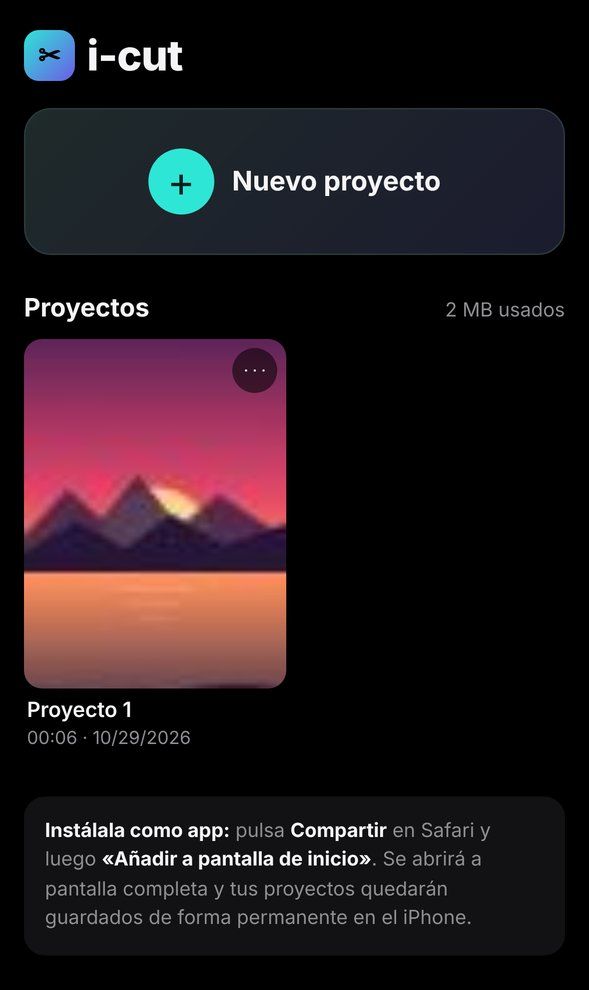
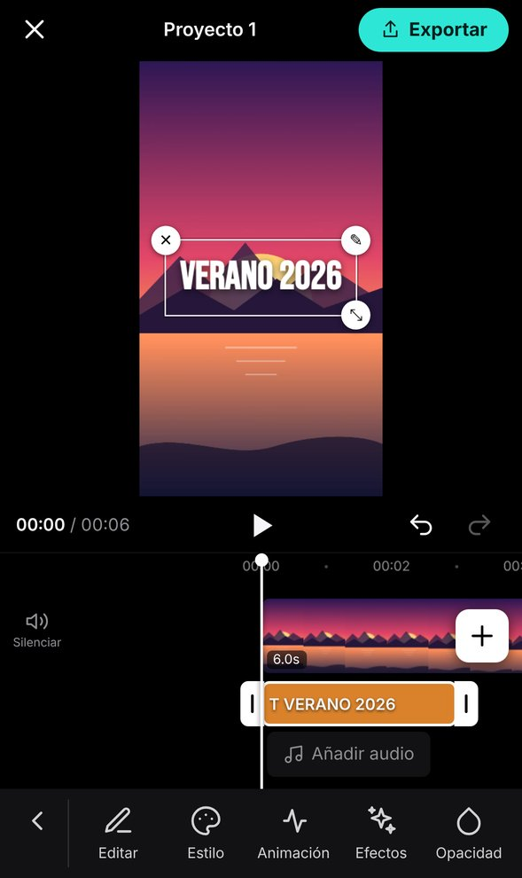
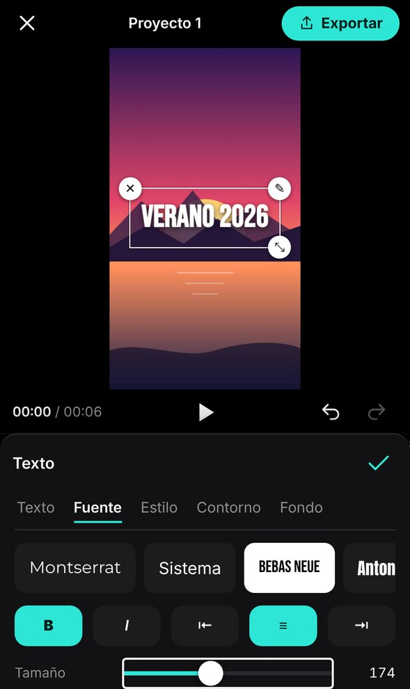
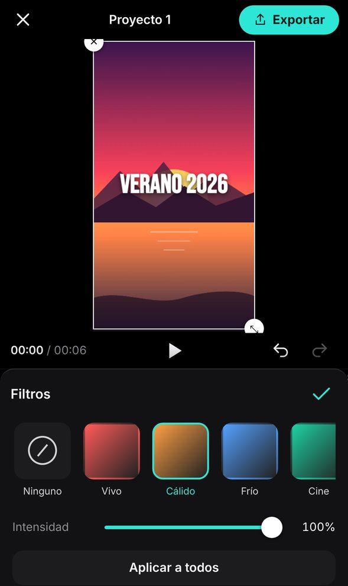
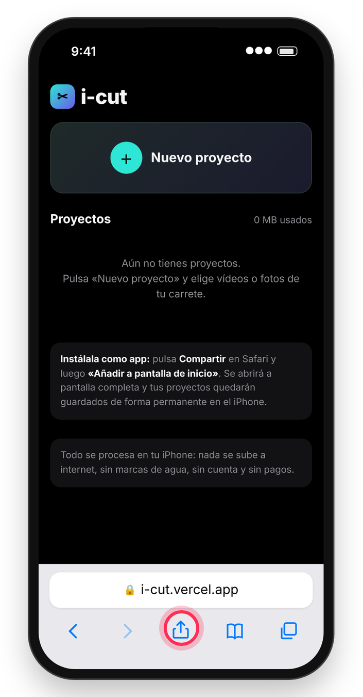
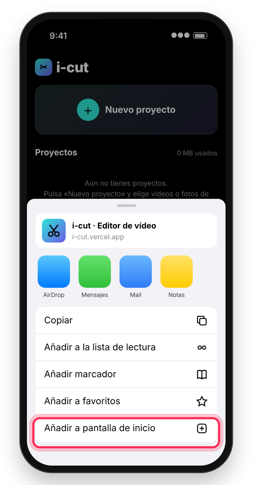
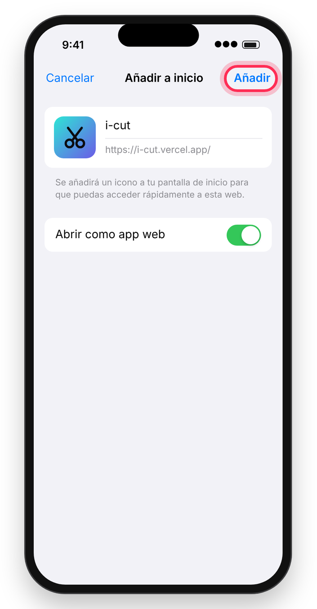
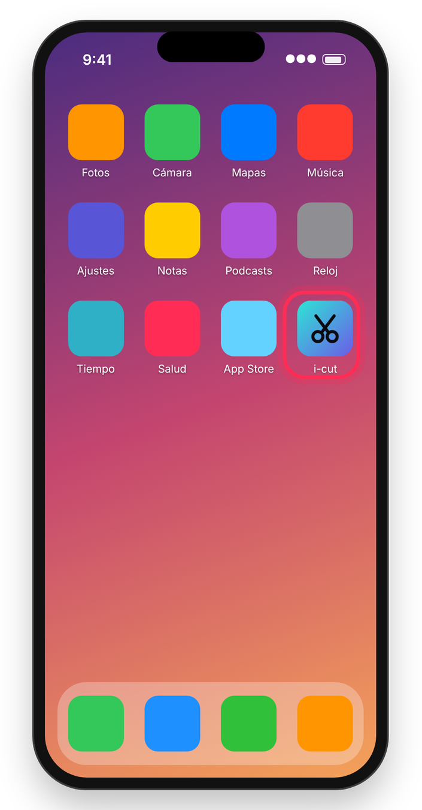
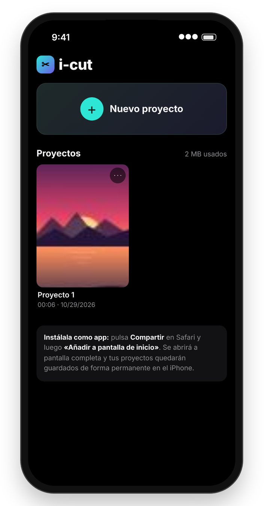

# i-cut

**i-cut es un editor de vídeo gratuito para iPhone.** Corta, une y monta tus vídeos y fotos, añade música, textos, subtítulos automáticos, filtros, efectos y transiciones, y guarda el resultado en tu carrete en hasta 4K.

Todo ocurre dentro de tu iPhone: tus vídeos no se suben a ningún sitio. No hay marcas de agua, no necesitas cuenta y no hay nada que pagar.

  
  
  
  

## Cómo instalarla en tu iPhone

i-cut no se descarga de la App Store: se instala desde Safari en menos de un minuto y después funciona como cualquier otra app, con su icono, a pantalla completa y también sin conexión.

| 1 | 2 | 3 |
| :---: | :---: | :---: |
|  |  |  |
| Abre **[i-cut.vercel.app](https://i-cut.vercel.app)** en **Safari** y pulsa el botón **Compartir**. | Desliza hacia abajo y elige **«Añadir a pantalla de inicio»**. | Deja activado **«Abrir como app web»** si aparece y pulsa **«Añadir»**. |

| 4 | 5 |
| :---: | :---: |
|  |  |
| Busca el icono de **i-cut** en tu pantalla de inicio y ábrela desde ahí. | ¡Listo! Se abre a pantalla completa. Pulsa **«Nuevo proyecto»** y elige vídeos o fotos de tu carrete. |

**Consejos**

- Si no ves el botón **Compartir** abajo, toca el botón **⋯** junto a la barra de direcciones y luego **Compartir**. Si la opción «Añadir a pantalla de inicio» no aparece en la lista, desplázate hasta abajo y pulsa **«Editar acciones»** para activarla.
- Tiene que ser **Safari**: desde otros navegadores el iPhone no siempre permite instalarla.
- Ábrela siempre desde el icono. Así tus proyectos quedan guardados de forma permanente; si la usas solo dentro de Safari, el iPhone puede borrarlos si pasas varios días sin abrirla.
- Las imágenes de los pasos son ilustraciones: según tu versión de iOS los menús pueden verse un poco distintos.

**Qué necesitas:** un iPhone con iOS 16.4 o posterior (recomendado iOS 17 o superior). Con versiones anteriores también funciona, pero la exportación es más lenta.

## Qué puedes hacer

**Montar tu vídeo**
- Proyectos guardados en el iPhone, con portada. Puedes duplicarlos, renombrarlos y borrarlos.
- Línea de tiempo táctil: desliza para moverte, pellizca para hacer zoom, mantén pulsado un clip para moverlo y arrastra sus bordes para recortarlo.
- Dividir, duplicar, eliminar, congelar fotograma, separar el audio y silenciar.
- Vídeos superpuestos (vídeo dentro de vídeo) y pantalla verde para quitar el fondo.
- Formatos para cada red: 9:16, 16:9, 1:1, 4:5 y más, con fondo desenfocado o de color.
- Deshacer y rehacer cuando quieras.

**Movimiento y velocidad**
- Velocidad de 0,1x a 10x y **curvas de velocidad** listas para usar (montaje, héroe, bala…).
- **Invertir** un clip para que se reproduzca hacia atrás.
- **Keyframes**: anima la posición, el tamaño, el giro, la opacidad, los filtros y el volumen a lo largo del clip.
- **Estabilizar** vídeos grabados a mano para quitar el temblor.
- Animaciones de entrada, salida y en bucle (aparecer, zoom, rebote, latido, Ken Burns…).
- 12 transiciones entre clips: fundido, destello, deslizar, zoom, barrido, giro y más.

**Color y efectos**
- 15 filtros (Cine, Vintage, B y N, Película…) con intensidad regulable.
- Ajustes de brillo, contraste, saturación, temperatura, luces, sombras, viñeta, grano y más.
- 13 efectos animados: glitch, VHS, temblor, RGB, píxel, espejo, cine viejo, arcoíris…

**Texto y subtítulos**
- Textos con 12 fuentes, colores, contorno, fondo y sombra.
- **Plantillas de texto animadas** para títulos con un toque.
- **Subtítulos automáticos** a partir de la voz del vídeo, en español, inglés, catalán, portugués, francés, italiano o alemán, con **estilos de subtítulos** como la palabra resaltada tipo karaoke.
- Más de 70 stickers y emojis.

**Audio**
- Música desde la app Archivos, voz en off con el micrófono y efectos de sonido.
- Volumen hasta el 200 %, fundidos de entrada y salida.
- **Quitar silencios y muletillas** automáticamente para que tus vídeos hablados vayan al grano.
- **Cambiador de voz**: robot, ardilla, eco, grave y más.

**Guardar y compartir**
- Exporta en MP4 desde 480p hasta 4K, a 24, 25, 30, 50 o 60 fps.
- Pulsa **«Guardar en Fotos / Compartir»** y elige **«Guardar vídeo»** para tenerlo en tu carrete, o envíalo directamente por WhatsApp, Instagram, TikTok…

## Preguntas frecuentes

**¿De verdad es gratis?** Sí. Sin suscripciones, sin compras dentro de la app y sin marca de agua en tus vídeos.

**¿Se suben mis vídeos a internet?** No. Todo se edita y se exporta dentro de tu iPhone. Solo se descarga de internet, una única vez, el modelo que genera los subtítulos automáticos.

**¿Funciona sin conexión?** Sí, una vez instalada. La única excepción es la primera vez que usas los subtítulos automáticos.

**La exportación se ha detenido.** Mantén i-cut abierta y la pantalla encendida mientras exporta: el iPhone pausa las apps que pasan a segundo plano. Si un vídeo muy largo en 4K falla, prueba con 1080p.

**¿Dónde están mis proyectos?** Guardados dentro del iPhone, en la propia app. Si borras i-cut de la pantalla de inicio, sus proyectos se borran también; los vídeos que ya hayas exportado a Fotos no.

---

¿Quieres colaborar o ver cómo está hecha? Consulta [DEVELOPING.md](DEVELOPING.md).

Código bajo licencia [MIT](LICENSE).
